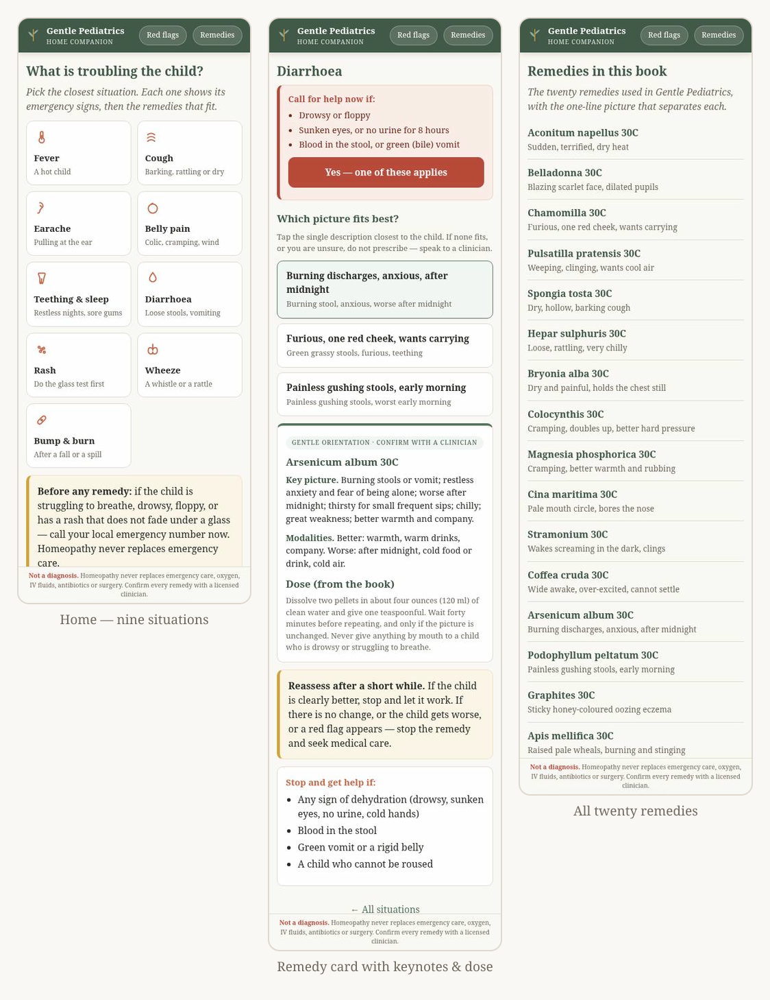

<div align="center">

# 🩵 Gentle Pediatrics — Home Companion

**A small, offline phone app for a parent at the cot side** — nine common childhood
situations, a red-flag check that is always visible, and gentle remedy orientation
from the book *Gentle Pediatrics: A Practical Homeopathic Companion* by Dr. Sohil Momin, B.H.M.S.

[](https://github.com/drsamonline/gentle-pediatrics-companion/blob/main/LICENSE)
[](https://github.com/drsamonline/gentle-pediatrics-companion)
[](https://github.com/drsamonline/gentle-pediatrics-companion)
[](https://drsamonline.github.io/gentle-pediatrics-companion/play/)
[](https://github.com/drsamonline/gentle-pediatrics-companion)

### [🌐 Landing page](https://drsamonline.github.io/gentle-pediatrics-companion/) &nbsp;·&nbsp; [▶️ Open the live app](https://drsamonline.github.io/gentle-pediatrics-companion/play/) &nbsp;·&nbsp; [💻 Source](https://github.com/drsamonline/gentle-pediatrics-companion)

**Download:** [Windows (.exe)](https://github.com/drsamonline/gentle-pediatrics-companion/releases/latest/download/gentle-pediatrics-companion-portable.exe) &nbsp;·&nbsp; [Android (.apk)](https://github.com/drsamonline/gentle-pediatrics-companion/releases/latest/download/gentle-pediatrics-companion.apk)

<sub>Not a medical device · educational aid only · in an emergency, call your local emergency number.</sub>

</div>

---

<div align="center">
  
  <br><br>
  <strong>A small, offline phone app for a parent at the cot side — built from the book <em>Gentle Pediatrics: A Practical Homeopathic Companion</em> by Dr. Sohil Momin, B.H.M.S.</strong>
  <br><br>
  <a href="https://drsamonline.github.io/gentle-pediatrics-companion/play/"></a>
  <a href="#license"></a>
  <a href="#install-it-like-an-app"></a>
  <br>
  
  
  
  
  <br><br>
</div>

---

<div align="center">
  
</div>

---

## What it does

- **Nine situations**, one tap from the home screen — fever, cough, earache,
  belly pain, teething & sleep, diarrhoea, rash, wheeze, and bump & burn.
- **A red-flag strip on every screen** — the two or three signs that are genuine
  emergencies for *that* situation, with a one-tap path to emergency help.
- **Remedy orientation** — tap the picture closest to the child and get the
  remedy card: the key picture, the modalities (better / worse), the dose from
  the book, a "reassess" note, and a "stop and get help if" list.
- **Remedies index** — all twenty remedies in the book, with the one-line picture
  that separates each.
- **Red flags page** — the full emergency list and the glass test.

Two taps gets a parent to a remedy. The emergency check is always visible, never
hidden, and never blocks the common case.

## Install it like an app

It is a Progressive Web App. Open the
**[live app](https://drsamonline.github.io/gentle-pediatrics-companion/play/)** on a
phone, then:

- **iPhone (Safari):** Share → *Add to Home Screen*
- **Android (Chrome):** ⋮ menu → *Add to Home screen* / *Install app*

It then runs **full screen and offline**, with no account, no analytics, and
nothing stored or sent.

## Run it locally

No build step, no dependencies. Open `index.html` in any browser, or serve the
folder:

```bash
python3 -m http.server 8080
# then open http://localhost:8080
```

## Safety notice — please read

This app is **not a diagnosis and not a substitute for a doctor.**

- Homeopathy never replaces emergency resuscitation, oxygen, IV fluids, indicated
  antibiotics or surgery.
- There are no homeopathic vaccines.
- Homeopathy's evidence base is contested in modern clinical research.
- If the child is struggling to breathe, is drowsy or floppy, has a rash that
  does not fade under a clear glass, or is a baby under 12 weeks with any fever —
  **call your local emergency number now** (108 / 112 India · 999 UK · 911 US).
  Do not give a remedy first.
- Always confirm any remedy with a licensed clinician.

The remedy keynotes and doses are condensed from the book and are for educational
orientation only.

## Files

| File | What it is |
|---|---|
| `index.html` | the app — a single self-contained file |
| `manifest.webmanifest` | PWA manifest |
| `sw.js` | offline service worker |
| `icon.svg` | app icon |
| `banner.svg` | README banner |
| `docs/screens.svg` | README screenshots |
| `docs/badges/` | README badges (local SVG) |
| `docs/Companion_App_Brief.md` | design & safety brief |

## Credits

Built from *Gentle Pediatrics: A Practical Homeopathic Companion* by
**Dr. Sohil Momin, B.H.M.S.** Clinical vignettes in the book are composite
teaching cases.

## License

**Free to use.** Copyright © 2026 Dr. Sohil Momin. Free to use, copy and share
for personal, educational and non-commercial purposes, with attribution and this
notice kept. Commercial use or resale needs written permission. See
[LICENSE](LICENSE) for the full terms and the medical disclaimer.

<div align="center"><sub>Not a medical device · educational aid only · in an emergency, call your local emergency number.</sub></div>
